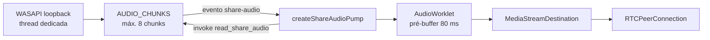

# Shell desktop (Tauri 2 + Rust)

Código em [src-tauri/](../src-tauri/). Crate `telinha` (lib `telinha_lib`), identificador `com.telinha.desktop`, janela principal `main`. Plataforma-alvo: **Windows** (WebView2). O código compila em outros sistemas, mas captura de áudio, permissões de mídia e detecção de GPU só funcionam no Windows.

## Módulos

| Arquivo | Responsabilidade |
| --- | --- |
| `src/lib.rs` | Plugins, comandos básicos, bandeja, atalho global, deep links, instância única, interceptação do fechar |
| `src/audio.rs` | Captura de áudio do sistema (WASAPI loopback) e fila de chunks PCM |
| `src/capture.rs` | Listagem de fontes, captura legada de quadros, `set_window_layout` |
| `src/gpu.rs` | Detecta GPU com encoder de hardware (para preferir H.264) |
| `src/native_share/` | **Experimental.** Captura (Windows Graphics Capture), codificação H.264 por hardware e envio por WebRTC (libwebrtc) em Rust, lista de fontes com miniaturas. Ver [Compartilhamento nativo](#compartilhamento-nativo-experimental) |
| `src/discord.rs` | Rich Presence do Discord (opcional) |
| `src/webview_permissions.rs` | Libera câmera/microfone no WebView2 sem prompt |

## Comandos (`invoke`) e eventos

| Comando | Usado pelo frontend? | Descrição |
| --- | --- | --- |
| `copy_to_clipboard(text)` | Sim | Copia código/diagnóstico |
| `show_main_window`, `hide_main_window` | Sim | Mostrar/esconder a janela (bandeja, convites) |
| `quit_app` | Sim | Para a captura e encerra o processo |
| `set_window_layout(layout)` | Sim | `"watch-dual"` (cresce a janela se for pequena), `"watch"` (tela cheia); qualquer outro valor mantém a janela como está |
| `gpu_encode_info` | Sim | `{available, vendor, name}` |
| `set_discord_presence(code)` | Sim | Define/limpa a sala exibida no Discord |
| `start_share_capture(id, fps, maxWidth, includeAudio, includeVideo)` | Sim, só com `includeVideo:false` | Inicia a captura de áudio (e, legado, de vídeo) |
| `read_share_audio` | Sim | Entrega os chunks PCM acumulados |
| `stop_share_capture` | Sim | Para a captura e limpa as filas |
| `list_share_sources`, `resolve_share_source`, `read_share_frame` | **Não** (legado) | Captura de tela por quadros JPEG via `xcap` |
| `native_share_capability` | Só com o interruptor experimental | `{available, vendor, encoder, reason}`: há captura + encoder H.264 por hardware na GPU de captura? |
| `native_share_sources` | Idem | Telas e janelas (`screen:<HMONITOR>` / `window:<HWND>`), sem miniaturas |
| `native_share_thumbnail(id, width?)` | Idem | Miniatura JPEG (data URL) de uma fonte (480 px; a prévia da própria live pede 960); separada da lista para o seletor abrir na hora |
| `native_share_icon(id)` | Idem | Ícone PNG (data URL) do aplicativo dono de uma janela; `null` para telas |
| `native_share_dev_record(id, seconds, maxHeight, fps, mbps)` | Idem, só em `dev` | Captura a fonte pelo pipeline real por alguns segundos e grava o H.264 na pasta temporária |
| `native_share_start(id, maxHeight, fps, maxMbps, includeAudio, relayCapKbps?)` | Idem | Começa a capturar e codificar (e, com `includeAudio`, a capturar o som); devolve `{width, height, encoder}`. Nada vai à rede até haver espectador |
| `native_share_offer(peerId, iceServers, relayOnly)` | Idem | Abre a conexão de um espectador e devolve o SDP da oferta |
| `native_share_answer(peerId, sdp)`, `native_share_ice(peerId, candidate, sdpMid, sdpMlineIndex)` | Idem | Resposta e candidatos ICE do espectador |
| `native_share_viewer_stop(peerId)`, `native_share_stop` | Idem | Fecha um espectador / encerra captura e todas as conexões |
| `native_share_stats` | Idem | `{viewers, targetKbps, framesPerSecond, sentKbps}` |

| Evento (Rust → JS) | Quando |
| --- | --- |
| `telinha-open-url` | Deep link recebido (ou segunda instância aberta com `telinha:`) |
| `toggle-share` | Atalho global `Ctrl+Shift+S` |
| `window-close-requested` | O usuário tentou fechar a janela (o fechamento real é bloqueado; o app mostra `ClosePrompt`) |
| `app-quit-requested` | "Sair" no menu da bandeja |
| `share-audio` | Há áudio novo para ler via `read_share_audio` |
| `share-audio-error` | Falha na captura de áudio (mensagem em texto) |
| `share-frame` | Quadro novo (legado) |
| `native-share-ice` | Candidato ICE gerado para um espectador (`peerId`, `candidate`, `sdpMid`, `sdpMlineIndex`) |
| `native-share-state` | Estado da conexão de um espectador (`peerId`, `state`) |
| `native-share-viewer` | A cada 2 s por espectador: `peerId`, `relay`, `rttMs`, `availableKbps` |
| `native-share-audio-error` | O som do computador não pôde ser capturado (`message`); o vídeo segue no ar sem áudio |
| `native-share-ended` | A captura terminou sozinha: `source-closed` (janela fechada) ou `error` |

## Compartilhamento nativo (experimental)

Objetivo: o app ter o próprio seletor de telas e janelas (como o Discord), o que o WebView2 não permite
com `getDisplayMedia`. Para isso a captura e a codificação saem do WebView e passam a rodar em Rust.
**Estado atual: captura, encoder, seletor, envio, áudio, prévia e recuperação de conexão funcionam de
ponta a ponta, atrás de um interruptor.** Sem o interruptor nada muda. A regra de qualidade é: o caminho
novo só vira padrão se igualar ou superar o `getDisplayMedia` atual. Medido até aqui (uma máquina, GPU
NVIDIA, loopback): fluidez e congelamentos empatados ou melhores sob perda e banda limitada; nitidez de
conteúdo estático empatada (SSIM ≈ 0,998 nos dois). Falta rede real entre duas máquinas e outras GPUs; o roteiro
está em [native-share-testing.md](native-share-testing.md).

**Ligar:** no diálogo "Compartilhar tela" do app desktop, o interruptor **"Seletor de telas próprio
(experimental)"** (grava `telinha-native-share` no `localStorage`; `VITE_NATIVE_SHARE=1` também liga). A
grade só aparece se `native_share_capability` disser que há encoder por hardware; senão o app volta ao
seletor do Windows com um aviso. Se o envio nativo falhar ao **começar** (sem encoder, captura que não abre), o
app cai sozinho no seletor do Windows e segue como antes; só não cai quando a falha é da fonte escolhida (a
janela fechou antes de começar).

```
WGC (HMONITOR/HWND) -> textura BGRA -> processador de vídeo D3D11 (NV12, letterbox, tamanho fixo)
  -> encoder H.264 por hardware (Media Foundation, da mesma GPU) -> quadros Annex B
  -> fonte "pré-codificada" do libwebrtc -> uma PeerConnection por espectador (GCC, pacer, NACK, PLI)

WASAPI loopback (`audio.rs`) -> PCM 16 bits 48 kHz estéreo -> fonte de áudio do libwebrtc (codifica em Opus)
  -> mesma PeerConnection, mesma stream (`telinha-share`) do vídeo
```

**Áudio.** Reaproveita a captura por processo do `audio.rs` (`start_audio_tap`): tela inteira = tudo menos
o Discord (ou, sem Discord, menos o próprio Telinha, para não devolver a live que se assiste); janela =
só o som daquele aplicativo. O libwebrtc recebe o PCM e codifica em Opus; a oferta sai marcada como estéreo
(`stereo=1;sprop-stereo=1;maxaveragebitrate=192000`, em `native_share/sdp.rs`), porque sem isso o Opus do
WebRTC vira mono. O microfone nunca é aberto (`set_adm_recording_enabled(false)`). Se a captura de som
falhar, o vídeo continua e o app avisa pelo evento `native-share-audio-error`. Quem assiste recebe vídeo e
áudio na mesma `MediaStream` (`ShareReceiver` entrega a live quando o vídeo chega).

**Por que libwebrtc:** é o motor que o Chrome e o Discord usam (o binário do Discord traz GoogCC, pacer,
FEC e tratamento de PLI). Uma pilha WebRTC em Rust puro (`webrtc-rs`) foi testada antes e controlou
bem pior o congestionamento. Aqui o libwebrtc cuida da rede e só pede ao encoder duas coisas: a taxa
que o caminho aguenta (`take_rate_control_request`) e keyframes (`take_keyframe_request`).

**Vários espectadores.** Há um encoder só, mas cada espectador tem a própria fonte de vídeo do libwebrtc
alimentada com os mesmos quadros (`Feed` em `sender.rs`). Assim cada controle de congestionamento pede a taxa
que o *seu* caminho aguenta, e o encoder produz a do **mais lento** (`rates::combine_targets`); sem isso valeria
o último pedido e o espectador mais fraco teria a fila entupida. Um keyframe pedido por qualquer um serve a
todos. Sair um espectador não interrompe os outros.

**Rota e limite do TURN.** A cada 2 s o Rust lê as estatísticas de cada conexão e descobre se o caminho escolhido
passa por um relay TURN. Nesse caso o espectador fica limitado a `turnMaxBitrateKbps` da sala (o mesmo limite que o
caminho comum respeita); se a rota voltar a ser direta, o limite sai. O evento `native-share-viewer` leva
`{peerId, relay, rttMs, availableKbps}` ao JS, que o transforma em amostras do indicador de qualidade da sala.

**Recuperação.** Quando a conexão de um espectador chega a `failed`, o `NativeSender` a refaz: na 1ª vez com
credenciais ICE novas (`GET /rooms/:code/ice-servers`), na 2ª forçando `relay` se a sala tem TURN. Depois de
2 tentativas desiste e mostra a mensagem de P2P bloqueado. Conectar zera a conta. Quem assiste só responde às
ofertas, então não precisa de lógica própria.

**Prévia da própria live.** Quem transmite vê um tile com a própria live. Como o envio nativo não tem
`MediaStream` no app, `room/nativePreview.ts` busca a cada 500 ms um quadro reduzido da fonte (o mesmo caminho
das miniaturas, em 960 px) e o desenha num canvas; a captura do canvas vira a stream do tile. É só uma prévia, com
poucos quadros por segundo, e **nunca é enviada a ninguém** (fica fora do `PeerManager`).

**Lista de fontes.** Cada janela mostra o ícone do aplicativo (`native_share_icon`, extraído do executável e
desenhado sobre a cor do cartão, então sem transparência a tratar). Janelas "fantasma" (estilos
`WS_EX_TRANSPARENT` ou `WS_EX_NOACTIVATE`: overlays da NVIDIA/Xbox, dicas) ficam fora da lista.

**Diagnóstico.** `Ctrl+Shift+D` copia o diagnóstico da sala a qualquer momento. Com a live nativa ele inclui
`native-share-stats` (taxa pedida ao encoder, fps e kbit/s enviados) e `peer-health` com
`channel: "native-share"` (RTT, rota direta/relay, bitrate e perda recebidos).

**Sinalização.** Fica toda no JavaScript (WebSocket). A live nativa usa uma conexão separada da
câmera/live legada, marcada com `channel` nas mensagens `offer`/`answer`/`ice`: `share-out` vem de quem
transmite, `share-in` de quem assiste. O servidor só repassa o campo; sem ele nada muda. Quem transmite
sempre oferece (ao receber `watch-started`); quem assiste só responde (`room/shareReceiver.ts`). Do lado
do transmissor, `room/nativeSender.ts` guarda os candidatos ICE que o Rust gera antes de a oferta sair
e os envia depois dela.

**Compatibilidade.** Um cliente antigo ignora `channel` e trataria a oferta nativa como uma oferta comum,
o que não funciona. Ao publicar, suba `MIN_APP_VERSION` (como em qualquer mudança de protocolo).

**Build.** O libwebrtc vem pré-compilado (baixado no build, ~500 MB em `target/`) e foi compilado com a
C runtime estática, então `src-tauri/.cargo/config.toml` liga `+crt-static` para o alvo
`x86_64-pc-windows-msvc`; sem isso o link falha com `LNK2038`. O CI do Windows passa a baixar o pacote
na primeira compilação (o cache do `rust-cache` cobre as seguintes).

**Limitações atuais:** só H.264 (a fonte pré-codificada não gera VP8; todo Chromium/WebView2 decodifica H.264, mas
não há plano B como o `forceVp8` do caminho comum); não dá para trocar resolução/fps no meio da live (a
qualidade escolhida vale até parar); a prévia é de poucos quadros por segundo; testado só com GPU NVIDIA, a
1080p e em loopback; telas HDR, jogos em tela cheia exclusiva e conteúdo protegido (DRM) não foram testados.

| Arquivo | O que faz |
| --- | --- |
| `native_share/geometry.rs` | Funções puras testadas em qualquer SO: id da fonte, tamanho de codificação, letterbox, estilos de overlay |
| `native_share/rates.rs` | Regras puras de taxa: o mais lento dita o encoder; limite de quem passa pelo relay |
| `native_share/sdp.rs` | Edição pura do SDP (Opus estéreo) |
| `native_share/pipeline.rs` | O pipeline (Windows). `run(opts, control, on_started, on_frame)`; `Control` ajusta bitrate e pede keyframe sem travar |
| `native_share/sender.rs` | Sessão de envio: libwebrtc, uma conexão e uma fonte por espectador, rota/limite, direção do encoder |
| `native_share/icons.rs` | Ícone do aplicativo de uma janela, em PNG |
| `native_share/mod.rs` | Comandos Tauri, lista de fontes, sonda de capacidade |
| `native_share/test_window.rs` | Janela mínima criada pelo próprio teste (nunca usa programas do usuário) |

Decisões que custaram caro para descobrir:

- **O encoder só respeita o GOP longo se `ICodecAPI` for configurado antes dos tipos de mídia.** Depois, ele
  emite um keyframe inteiro por segundo, que estoura buffers de rede.
- **O MFT de hardware é escolhido pelo vendor da GPU de captura** (`MFT_ENUM_HARDWARE_VENDOR_ID_Attribute`); o
  primeiro da lista pode ser de outra GPU e falha com "memória insuficiente".
- **O Media Foundation é iniciado uma vez por processo e nunca encerrado** (`MFShutdown` ao fim de cada
  captura derrubava a captura seguinte com `STATUS_ACCESS_VIOLATION`).
- O evento `Closed` do WGC não é confiável para janelas; o pipeline também confere `IsWindow` a cada 250 ms.
- Janela redimensionada: o tamanho de saída é fixo; o conteúdo é centralizado com barras pretas (letterbox).
- Tela parada não gera quadros no WGC; o último quadro é reenviado a cada 500 ms para o fluxo não morrer.

Os testes que usam GPU e área de trabalho ficam em `#[ignore]`; rode-os localmente (abrem uma janela
própria por alguns segundos). `streams_h264_to_a_libwebrtc_viewer` cobre o envio inteiro: captura uma
janela de teste, negocia oferta/resposta/ICE e confere que um espectador libwebrtc decodifica o vídeo:

```
cd src-tauri && cargo test native_share -- --ignored --test-threads=1
```

## Janela, bandeja e fechamento

- Fechar a janela **não** encerra o app: `CloseRequested` é cancelado e o evento `window-close-requested` abre um diálogo (minimizar para a bandeja, sair da sala ou encerrar).
- Bandeja: "Mostrar Telinha" e "Sair"; clique esquerdo mostra a janela.
- Layouts (`set_window_layout`): a janela **não é redimensionada** ao trocar de tela (sala, câmeras, uma live): ela fica como a pessoa deixou. `set_min_size` reaplica o tamanho atual e desmaximiza/reposiciona a janela, então só é chamado ao sair da tela cheia.
  - `watch-dual` (lado a lado) só **cresce** a janela, uma vez na troca de layout, até 960×540 quando ela é menor; nunca encolhe, e não mexe em janela maximizada ou em tela cheia.
  - `watch` é tela cheia (mín. 800×500). Ao sair, a janela volta maximizada se estava maximizada antes; senão, para 720×580 (mín. 640×500).
- `app.windows[0].additionalBrowserArgs` (`tauri.conf.json`) **substitui** os argumentos padrão do WebView2. Os três `--disable-features=msWebOOUI,msPdfOOUI,msSmartScreenProtection` são os padrões do Tauri e devem ser mantidos; `--enable-features=AllowWgcWindowCapturer` usa a captura moderna do Windows para janelas aparecerem no seletor.
- Plugin de instância única: abrir o app de novo reaproveita a janela existente e repassa as URLs `telinha:` recebidas.

## Deep links

Esquema `telinha` (registrado em `tauri.conf.json`). Em builds de debug, `register_all()` registra o esquema no arranque. Formatos tratados no frontend (`lib/api.ts` `parseTelinhaUrl` e `lib/deepLink.ts`):

- `telinha://join?code=ABC123&name=Ana` ou `telinha://join/ABC123`
- `telinha://share`
- qualquer outra coisa válida: apenas abre/mostra o app.

## Áudio do sistema (`audio.rs`)

Formato fixo: **48 kHz, estéreo, float 32 bits**, em chunks de 1 920 frames (40 ms). A fila (`AUDIO_CHUNKS`) guarda no máximo 8 chunks; os mais antigos são descartados.



Origem do áudio, conforme a fonte escolhida:

| Fonte | Captura |
| --- | --- |
| `window:<id>` com PID conhecido | Loopback **só daquele aplicativo** (`new_application_loopback_client(pid, true)`, inclui a árvore de processos) |
| `screen:<id>` | Loopback do sistema **excluindo a árvore de processos do Discord** (`new_application_loopback_client(discord_pid, false)`) |

Comportamentos a conhecer:

- **Na prática, só o caminho `screen:` é usado hoje**: o frontend sempre chama `start_share_capture` com o id fixo `"screen:windows-picker"` (o seletor real de janela/tela é o do WebView2, que o Rust não enxerga). O ramo por janela/PID existe, mas não é exercitado pelo app atual.
- Para telas inteiras, o código **exige encontrar o Discord** (`discord.exe`, `discordcanary.exe`, `discordptb.exe` ou `vesktop.exe`). Sem ele, a captura falha com "Discord não encontrado; áudio da live desativado" e o app mostra o erro de áudio do sistema.
- Em qualquer falha, a thread emite `share-audio-error` e passa a enviar **silêncio** a cada 40 ms para a faixa de áudio não travar.
- Fora do Windows, `run_capture` retorna erro imediato.

No frontend (`media/shareAudio.ts`) o PCM entra em um `AudioWorkletProcessor` com pré-buffer de `PLAYOUT_DELAY_MS` (80 ms, em `media/playout.ts`) e descarte de excesso acima de ~1 s. Se `AudioWorklet` falhar, há fallback para `ScriptProcessor`.

## Detecção de GPU (`gpu.rs`)

Enumera adaptadores DXGI, ignora o driver básico da Microsoft e escolhe por prioridade NVIDIA → AMD → Intel. `available: true` para esses três fabricantes. O frontend usa isso para decidir se prefere H.264 (codificação por hardware no Chromium) ou VP8.

## Discord Rich Presence

Só funciona se a variável de ambiente **`TELINHA_DISCORD_APP_ID`** estiver definida (e diferente do placeholder `your_discord_app_id`). Uma thread em segundo plano reconecta ao Discord e atualiza "Sala XXXXXX" a cada 8 s. Sem a variável, o módulo não faz nada.

## Permissões e segurança

- `capabilities/default.json` lista o que o frontend pode chamar (janela, clipboard, atalho global, deep link, updater, process restart). **Todo plugin/comando novo precisa de permissão ali.**
- CSP em `tauri.conf.json` (`app.security.csp`): `connect-src` enumera os hosts permitidos, incluindo `http(s)://localhost:3001`, `ws(s)://localhost:3001` e **`https://telinha-server.onrender.com` / `wss://…`**. Para usar outro domínio de servidor, é preciso editar a CSP, senão as requisições são bloqueadas no app empacotado. Também libera `github.com` e domínios de releases para o updater.
- `webview_permissions.rs`: responde "permitir" apenas a pedidos de câmera e microfone (testado; qualquer outro tipo é ignorado).
- Updater: chave pública em `plugins.updater.pubkey`, endpoint `https://github.com/llorenzocardoso/telinha/releases/latest/download/latest.json`, `installMode: "passive"`.

## Perfil de release (`Cargo.toml`)

`opt-level = 3`, `lto = true`, `codegen-units = 1`, `panic = "abort"`, `strip = true`. Compilações de release são lentas por isso; use `tauri dev` no dia a dia.

## Testes e lint Rust

```powershell
cargo fmt --check --manifest-path src-tauri/Cargo.toml
cargo clippy --manifest-path src-tauri/Cargo.toml --all-targets -- -D warnings
cargo test --manifest-path src-tauri/Cargo.toml
```

Há testes unitários para: formato JPEG, fila de PCM, escolha do processo raiz do Discord (Windows), escolha de GPU e filtro de permissões do WebView2. O CI roda `cargo fmt --check` em Linux e `cargo test` + `clippy -D warnings` em runner Windows quando algo em `src-tauri/**` muda.

## Receita: adicionar um comando Tauri

1. Escreva a função com `#[tauri::command]` no módulo apropriado.
2. Registre em `tauri::generate_handler![...]` em `lib.rs`.
3. Se usar plugin novo, adicione-o em `Cargo.toml`, ao `Builder` e à lista de permissões em `capabilities/default.json`.
4. No frontend, chame com `invoke("nome", { argumentosEmCamelCase })` e trate a rejeição (o resto do código usa `.catch(() => undefined)` para funcionar também no navegador).
5. Em testes web (`npm run dev:solo`) o Tauri não existe; use `isTauriRuntime()` (`lib/runtime.ts`) antes de depender de um comando.
